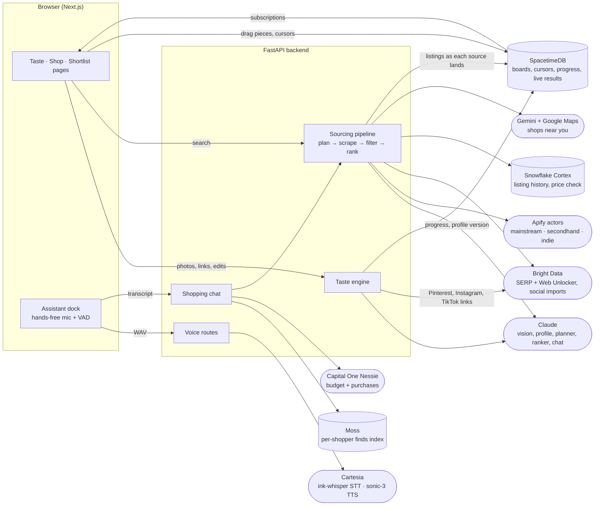

# Niche

Upload outfits and clothes you love. Claude builds an editable taste profile from them, and agents source matching pieces from major retailers (Nordstrom, Madewell, Zara and 100+ more via Google Shopping) and from secondhand and small sellers (Depop, Poshmark, Vinted, Etsy, Grailed), ranked by Claude in one list. There are no sponsored placements.

Who owns what, and which sponsor tools each feature uses: **[docs/WORKPLAN.md](docs/WORKPLAN.md)**.

## Layout

```
backend/          FastAPI, Python 3.11+
  app.py          one process: sourcing + taste + checkout routers
  sourcing/       Apify marketplace search + Claude query planning/ranking (prior Person 3 work; see SOURCING.md)
  actors/         Niche's two Apify actors: niche-mainstream (retailer bank) and niche-secondhand (see actors/README.md)
  taste/          image upload, palette, Claude extraction → clustering → taste profile, edits
  checkout/       "Mark as bought": records purchases (made on the store's site) to the shopper's Nessie budget
  tests/
web/              Next.js 15 (App Router) + Tailwind v4
  app/            / landing · /onboard setup questions · /taste uploads, moodboard, profile · /shop search + checkout
  components/     chrome (header/footer), drawer, hand-drawn circle, image tile, assistant (voice + text, on every page), checkout
  lib/            API client, shared types
spacetime/        SpacetimeDB module: shared moodboard, cursors, build progress, streaming search results
docs/             workplan
```

## How it fits together



## Sponsor tools

What each tool does in the product, and what it doesn't: **[docs/SPONSORS.md](docs/SPONSORS.md)**. In short: Claude
builds the taste profile and ranks results; Apify actors run all product search; Cartesia is the assistant's voice
(setup, features and known limitations in [docs/SPONSORS.md#cartesia](docs/SPONSORS.md#cartesia)); SpacetimeDB carries
live state (shared moodboard, cursors, streaming results); Bright Data finds indie shops on any platform and imports
lookbooks; Moss is the shopping chat's memory; Nessie keeps the agent inside your budget; Snowflake Cortex checks a
price against the market; Gemini suggests shops near you.

## Run it

```sh
# API — http://127.0.0.1:8000/docs
cd backend
uv venv && uv pip install -e '.[dev]'     # or: python -m venv .venv && pip install -e '.[dev]'
cp .env.example .env
.venv/bin/uvicorn app:create_app --factory --reload --port 8000

# Live state — SpacetimeDB on :3100 (setup details in spacetime/README.md)
spacetime start --listen-addr 127.0.0.1:3100
cd spacetime && npm install && npm run publish:local

# Web — http://localhost:3000
cd web
cp .env.example .env.local
npm install && npm run dev
```

Everything runs with **no API keys** in fixture mode:
- `TASTE_MODE=fixture` builds the profile from measured palettes only, with no Claude call.
- `SOURCING_MODE=fixture` returns synthetic listings that are clearly labelled and can't be purchased.

Turn on real services one at a time:

| Setting (backend/.env) | Enables |
|---|---|
| `TASTE_MODE=live` + `ANTHROPIC_API_KEY` (or `NICHE_ANTHROPIC_API_KEY`) | Claude extraction, clustering and edits (`claude-opus-5-5`) |
| `SOURCING_MODE=live` + `APIFY_TOKEN` + `ANTHROPIC_API_KEY` | Real marketplace listings. Runs cost money; read `backend/SOURCING.md` first |
| `NESSIE_API_KEY`, then `python -m finance.seed <profile_id>` | Budget-aware shopping agent: links a Capital One Nessie demo bank account (balance, this month's clothing spend, upcoming bills); demo purchases are recorded to it |

## Debugging Claude

Every Claude stage (`extract`, `synthesize`, `edit`, `planner`, `ranker`) logs its system prompt to the server log. It also writes `prompt` and `model_usage` rows to the `events` table in `backend/data/sourcing.sqlite3`. Claude calls use server-side refusal fallback (`fallbacks: "default"`).

## Tests

```sh
cd backend && .venv/bin/python -m pytest -q
cd web && npm run lint && npm run build
```

## Design

The reference is page 3 of the frontend design deck: a geometric, gridded, archival museum look. The system is white paper, black ink, grey `plinth` image tiles and 1px rules, all in one typeface (Inter Tight). Labels are small and uppercase; headings are 28px and set in normal case. Tokens live in `web/app/globals.css`.
